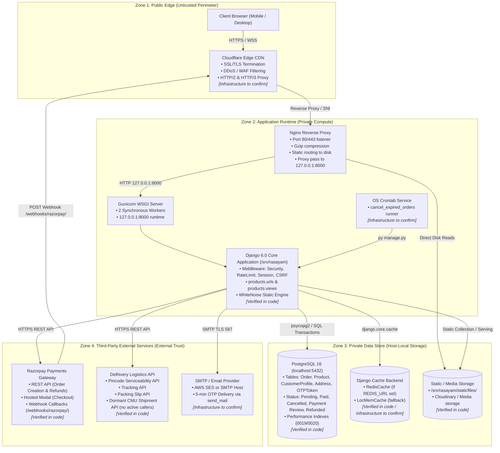
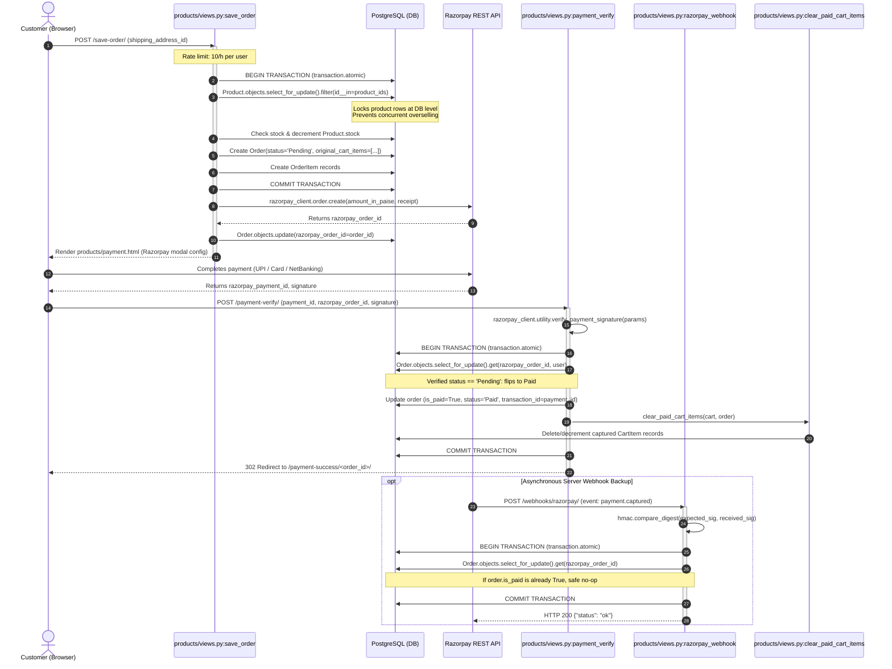
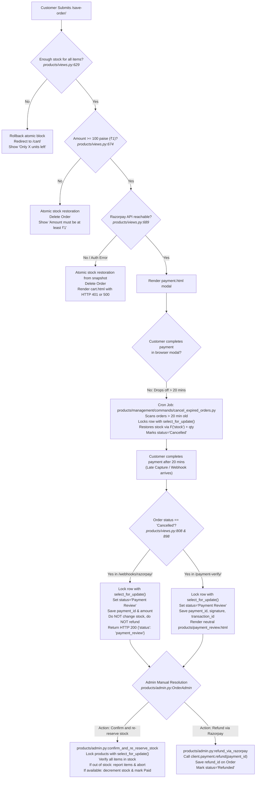
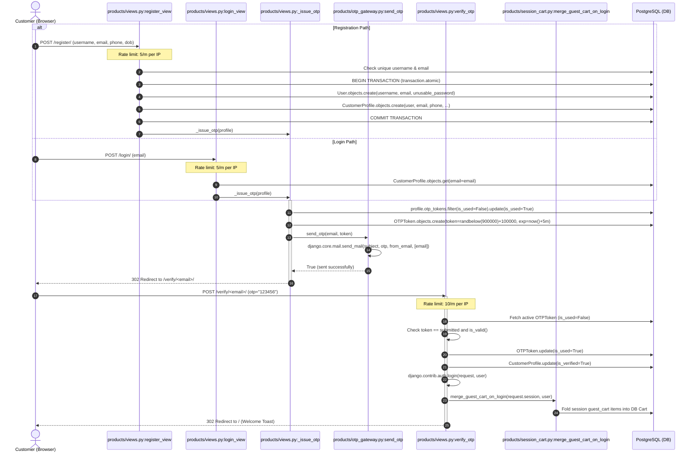
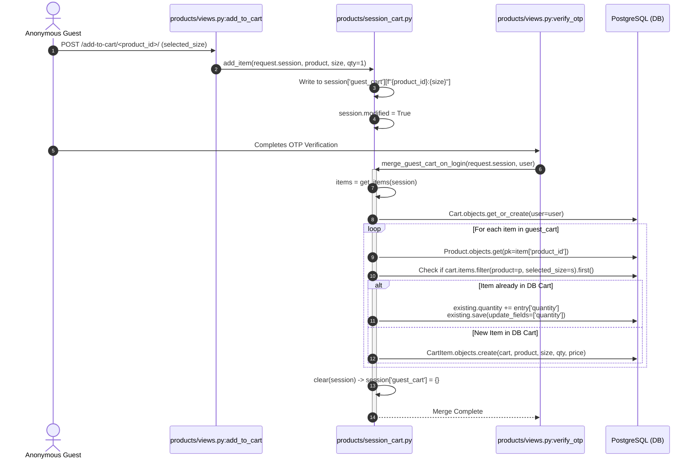
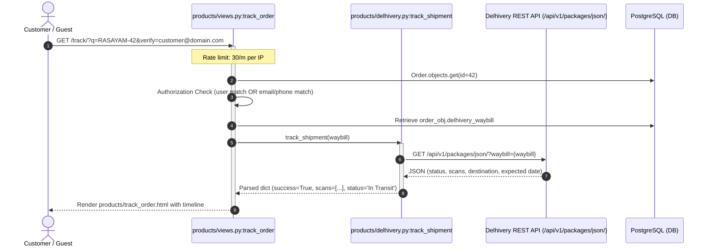
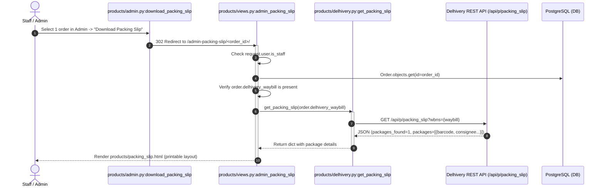
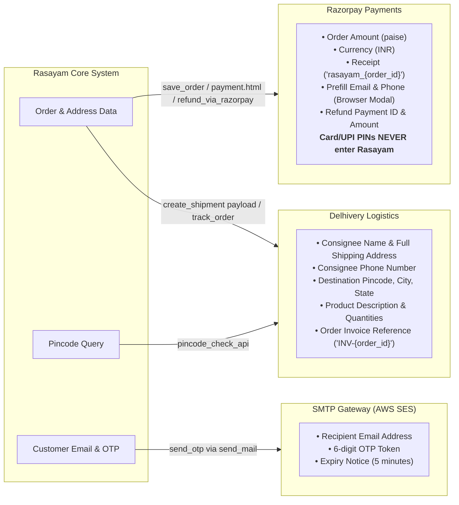

# Rasayam: System Architecture & Data Flow Specification

This document specifies the end-to-end architecture, sequence flows, data classification, concurrency behavior, and infrastructure dependencies for the Rasayam luxury ethnic wear e-commerce platform (`rasayamglobal.com`, Django 6.0).

---

## 1. Static Architecture & Trust Zones

### Master Topology Diagram



### Component Verification Matrix

| Component | Trust Zone | Verification Status | Operational Notes & Code Reference |
| :--- | :--- | :--- | :--- |
| **Cloudflare CDN** | Public Edge | **Infrastructure to confirm** | Identified in production response headers (`Cf-Ray`, `cf-cache-status: DYNAMIC`). WAF firewall rules, SSL mode (Strict/Full), and HTTP/3 caching require dashboard verification. |
| **Nginx Reverse Proxy** | Application Runtime | **Verified in code** | Configured in `nginx.conf` with proxy headers (`X-Forwarded-For`, `X-Forwarded-Proto`), gzip compression, and direct static asset routing. |
| **Gunicorn WSGI** | Application Runtime | **Verified in code** | Configured via `start_gunicorn.sh` (2 synchronous workers binding to `127.0.0.1:8000`). |
| **Django Application** | Application Runtime | **Verified in code** | Application settings in `Rasayam_website/settings.py` and URL endpoints in `products/urls.py`. |
| **Stock Cleanup Cron** | Application Runtime | **Infrastructure to confirm** | Command logic verified in `products/management/commands/cancel_expired_orders.py`. OS crontab schedule (`*/10 * * * *`) requires host verification. |
| **PostgreSQL 16** | Private Data | **Verified in code** | Engine verified in `settings.py:142`. Models and constraints verified in `products/models.py`. |
| **Cache Engine** | Private Data | **Infrastructure to confirm** | `settings.py:181-200` conditionally binds `RedisCache` if `REDIS_URL` is configured, otherwise silently falling back to `LocMemCache`. |
| **Static / Media Storage** | Private Data | **Verified in code** | Static files served through WhiteNoise (`settings.py:56`). Media uses Cloudinary / local fallback (`settings.py:270-295`). |
| **Razorpay Payments** | Third-Party | **Verified in code** | Handled in `products/views.py:save_order`, `payment_verify`, `razorpay_webhook`, and `products/admin.py:refund_via_razorpay`. |
| **Delhivery Logistics** | Third-Party | **Verified in code** | Endpoints verified in `products/delhivery.py`. `create_shipment` verified as dormant. |
| **SMTP / Email Gateway** | Third-Party | **Infrastructure to confirm** | `settings.py:458-468` reads `EMAIL_HOST`. `.env.example` lists AWS SES, but production credentials and sender DNS records require confirmation. |

---

## 2. Sequence Flows (Happy Paths, Failure Paths & Payment Review)

### Use Case 1: Checkout, Payment, Late Capture & Stock Recovery

#### Happy Path



#### Explicit Failure & Late Capture Paths



---

### Use Case 2: OTP Login and Registration

#### Happy Path



#### Failure Paths
- **Failure B1: Rate Limit Blocked (`products/views.py:326, 387, 413`):** IP exceeds 5/min on register/login or 10/min on verify; returns HTTP 403 Forbidden via `django-ratelimit (block=True)`.
- **Failure B2: Duplicate Email on Register (`products/views.py:342`):** `CustomerProfile.objects.filter(email=email).exists()` is true; re-renders form with error "This email is already registered."
- **Failure B3: Unregistered Email on Login (`products/views.py:398`):** `CustomerProfile.DoesNotExist` caught; redirects to `/register/` with toast.
- **Failure B4: Resend Cooldown (`products/views.py:372`):** Token created $<60$ seconds ago (`OTPToken.RESEND_COOLDOWN_SECONDS`); returns notice with remaining seconds without dispatching duplicate email.
- **Failure B5: SMTP Outage (`products/otp_gateway.py:37`):** `send_mail` throws exception; logged as error, view returns "Failed to send OTP. Please try again later."
- **Failure B6: Invalid OTP Submission (`products/views.py:438`):** Increments `otp_obj.attempts += 1`. If attempts $<5$, re-renders with remaining attempt count.
- **Failure B7: Max Attempts Exceeded (`products/views.py:441`):** `attempts >= 5`. Burns token (`otp_obj.is_used = True`), redirects to `/login/` with "Too many incorrect attempts."
- **Failure B8: Expired OTP Token (`products/views.py:420`):** Submitted after 5 minutes; `is_valid()` returns `False`, redirects to `/login/`.

---

### Use Case 3: Cart Merge on Login

#### Happy Path



#### Failure Paths
- **Failure C1: Orphaned Product ID (`products/session_cart.py:98`):** If a product is deleted while held in an anonymous session, `Product.DoesNotExist` is caught and skipped (`continue`), preserving remaining valid items.
- **Failure C2: Empty Session Cart (`products/session_cart.py:92`):** Returns immediately without DB operations.
- **Failure C3: Stock Ceiling Deferred:** `merge_guest_cart_on_login` does not query `Product.stock`. Stock limits are enforced at checkout in `products/views.py:save_order` via `select_for_update()`.

---

### Use Case 4: Delhivery Shipment Creation and Tracking

#### Happy Path (Public Tracking & Admin Slip Generation)



#### Failure Paths
- **Failure D1: Invalid / Unserviceable Pincode (`products/views.py:1205`):** Non-6 digit pincode returns HTTP 400. Unserviceable code returns `{'serviceable': False}`.
- **Failure D2: Delhivery API Timeout (`products/delhivery.py:72, 136`):** `requests.RequestException` caught after 15s timeout; logs error, returns fallback dictionary `{'success': False, 'error': str(exc)}`.
- **Failure D3: Order Enumeration Prevented (`products/views.py:1162`):** Guest querying Order ID without registered phone/email verification parameter receives `{'need_verification': True}`, preventing PII leakage.
- **Failure D4: Unshipped Order (`products/views.py:1171`):** Valid order with empty `delhivery_waybill` returns "Order has not been shipped yet."
- **Status of `create_shipment` (Dormant):**
  - **Code Reality:** `products/delhivery.py:create_shipment(order)` formats a payload for Delhivery's `/api/cmu/create.json` endpoint, but has **zero active callers** across views, admin actions, or management commands.
  - **Production Reality:** Administrators assign `delhivery_waybill` manually via `products/admin.py:OrderAdmin`.
  - **Open Decision:** Adding a `"Create Delhivery Manifest"` admin action to invoke `create_shipment` and auto-assign the waybill is pending confirmation.

---

### Use Case 5: Admin Packing Slip Flow

#### Happy Path



#### Failure Paths
- **Failure E1: Non-Staff Access (`products/views.py:1306`):** Redirects unauthorized users to `index` (`/`).
- **Failure E2: Missing Waybill (`products/views.py:1310`):** Redirects admin to order change page with message `"This order does not have a Delhivery waybill assigned yet."`
- **Failure E3: Multi-Select Warning (`products/admin.py:192`):** Selecting $>1$ order shows admin warning `"Please select only one order to download the slip at a time."`
- **Failure E4: Delhivery API Error (`products/delhivery.py:327`):** Returns `{'packages_found': 0, 'error': ...}`, rendered gracefully without an unhandled 500 error.

---

## 3. Data Classification & Boundaries

### Data Stores (Data Held Internally)

| Store / Component | Model / Data Structure | Fields & PII Held | Retention & Privacy Scope |
| :--- | :--- | :--- | :--- |
| **PostgreSQL** | `CustomerProfile` (`products/models.py:5`) | Email, phone, city, state, gender, date_of_birth, `is_verified`. | Permanent until user deletion. |
| **PostgreSQL** | `User` (Django `auth_user`) | Username, email, first/last name, unusable password hash, login time. | Permanent account record. |
| **PostgreSQL** | `Address` (`products/models.py:20`) | Full name, phone, pincode, flat/building, street, landmark, city, state, default flag. | Permanent until modified by user. |
| **PostgreSQL** | `Order` (`products/models.py:195`) | User FK, total_amount, status (`Pending`, `Paid`, `Cancelled`, `Payment Review`, `Refunded`), shipping address text, `original_cart_items` JSON (product, size, qty, price), `transaction_id`, `razorpay_order_id`, `razorpay_payment_id`, `razorpay_signature`, `refund_id`, `delhivery_waybill`, `delhivery_shipment_status`. | Permanent financial record. Pending orders cancelled after 20m. Late captures held under `Payment Review`. |
| **PostgreSQL** | `OTPToken` (`products/models.py:74`) | Profile FK, plaintext 6-digit token, `created_at`, `expires_at`, `is_used`, `attempts`. | Single live token per profile; expires in 5m. |
| **PostgreSQL** | `Cart` & `CartItem` (`products/models.py:241`) | User FK, product FK, selected size, quantity, unit price. | Cleared on successful checkout. |
| **Session Store** | `request.session['guest_cart']` (`products/session_cart.py:14`) | Dictionary of `{product_id}:{size}` $\rightarrow$ `{product_id, size, quantity, price}`. | Cleared on login merge or session expiry. |
| **Cache Engine** | `delhivery_pin_{pincode}`, `ratelimit:*` | Delhivery serviceability response (city, state, prepaid/cod, 24h TTL). Rate limit attempt counters. | Auto-expiring TTLs. No customer PII cached. |

### External Services (Data Leaving the System)



---

## 4. Idempotency, Concurrency & State Invariants

### 1. Webhook Deduplication & Payment Review
- **Endpoint:** `products/views.py:razorpay_webhook`
- **Locking & Atomic Scope:**
  ```python
  with transaction.atomic():
      order = Order.objects.select_for_update().get(razorpay_order_id=razorpay_order_id)
      if order.is_paid or order.status == 'Payment Review':
          return JsonResponse({'status': 'ok'})
      if order.status == 'Cancelled':
          order.status = 'Payment Review'
          order.razorpay_payment_id = payment_id
          order.transaction_id = payment_id
          if amount_decimal is not None:
              order.total_amount = amount_decimal
          order.save(update_fields=['status', 'razorpay_payment_id', 'transaction_id', 'total_amount'])
          return JsonResponse({'status': 'payment_review'})
      order.is_paid = True
      order.status = 'Paid'
      ...
  ```
- **Idempotency Guarantees:**
  - Repeated deliveries for an order already `Paid` return HTTP 200 without duplicate execution.
  - Repeated deliveries for an order already in `Payment Review` return HTTP 200 without changing state.
  - Late captures arriving for `Cancelled` orders are intercepted before any stock mutations occur, moving safely to `Payment Review`.

### 2. Browser Verification Path (`payment_verify`)
- **Endpoint:** `products/views.py:payment_verify`
- **Mechanism:** Acquires row lock via `select_for_update()`. If `order.status == 'Cancelled'`, sets status to `'Payment Review'`, records payment credentials, and renders `products/payment_review.html` informing the customer that inventory is being verified by the concierge team.

### 3. Stock Locking & Recovery Concurrency
- **Checkout Reservation (`products/views.py:save_order`):** Product rows locked with `select_for_update()` inside `transaction.atomic()`. Concurrent requests serialize at the DB row level, preventing overselling.
- **Stock Recovery (`products/management/commands/cancel_expired_orders.py`):** Pending orders older than 20 minutes locked with `select_for_update()`. Evaluates `if order.status == 'Pending':` before restoring stock via `F('stock') + quantity` and marking `Cancelled`.
- **Elimination of Race Condition:** Because `razorpay_webhook` and `payment_verify` also lock the order row with `select_for_update()`, a late capture can never interleave with the cleanup job. If cleanup commits first, the capture sees `status == 'Cancelled'` and transitions to `Payment Review` rather than `Paid`.

### 4. Admin Action Concurrency & Safety
- **Action 1: "Confirm and re-reserve stock" (`products/admin.py:OrderAdmin.confirm_and_re_reserve_stock`):**
  - Evaluates `if order.is_paid or order.status == 'Paid':` (idempotent skip).
  - Inside `transaction.atomic()`, locks `Product` rows with `select_for_update()`.
  - Verifies stock for all snapshot items. If any item is insufficient, reports the exact item name, requested quantity, and available quantity via admin error message and aborts without partial deductions.
  - If all items available, decrements stock and sets `is_paid = True, status = 'Paid'`.
- **Action 2: "Refund via Razorpay" (`products/admin.py:OrderAdmin.refund_via_razorpay`):**
  - Evaluates `if order.status == 'Refunded' or order.refund_id:` (idempotent skip).
  - Invokes `client.payment.refund(order.razorpay_payment_id, {'amount': paise})`.
  - Stores `order.refund_id = refund_id` and sets `status = 'Refunded'`.

---

## 5. Open Questions & Infrastructure To Confirm

1. **Redis Cache Configuration in Production:**
   - [`settings.py:181-200`](file:///C:/Users/debab/OneDrive/Desktop/Rasayam-org-git-developer/Rasayam-website/Rasayam_website/settings.py#L181-L200) falls back to `LocMemCache` if `REDIS_URL` is unset.
   - Under multi-worker Gunicorn (2 workers), `LocMemCache` isolates memory per worker process, causing rate limit counters (`@ratelimit`) to be evaluated per-worker rather than globally.
   - *Confirmation needed:* Confirm whether Redis is provisioned and `REDIS_URL` is defined in the production `.env`.

2. **Crontab Execution Schedule on Production Host:**
   - The stock recovery command is tested and verified at `products/management/commands/cancel_expired_orders.py`.
   - *Confirmation needed:* Confirm that the crontab entry on the EC2 host (`*/10 * * * *`) is active and whether a centralized runner (Celery Beat or AWS EventBridge) should be configured.

3. **SMTP Provider & DNS Delivery Records:**
   - `settings.py:458-468` reads `EMAIL_HOST` and credentials from environment variables.
   - *Confirmation needed:* Confirm the active production SMTP provider (AWS SES Mumbai `email-smtp.ap-south-1.amazonaws.com` vs other) and verify that SPF, DKIM, and DMARC DNS records are active for `admin@rasayamglobal.com` to prevent OTP codes landing in spam.

4. **"Create Delhivery Manifest" Admin Action Decision:**
   - `products/delhivery.py:create_shipment` is dormant with no callers in views or admin.
   - *Open Decision:* Should we wire up a `"Create Delhivery Manifest"` admin action in `OrderAdmin` to automatically dispatch shipments to Delhivery's CMU API and record the assigned waybill, or should admin staff continue manual waybill entry?
